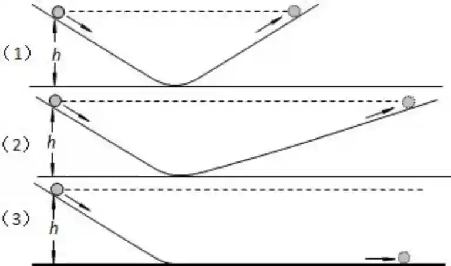

2026-11-27 00:29–00:47

我一直反对一个东西，就是科学本质上不是实验学，不是测量学。可观测、可证伪、可复现，这些都是科学的一个分支，不能用来定义完整的科学，因为科学中最主要的部分，恰恰是不具备这三点的。

我认为科学如今发展成了实验科学，主要是教育模式导致的。因为大学制度的存在，需要一种合理化的方式去安置大量从业于科研的人口。而给各种能科研和不能科研的人都留一条基本的道，就需要一种很机械、很工业化的方式去定义科研，所以实验科学慢慢成为了主流认知。

但是科学的内核从不源于数据。我之前经常提到一件事：伽利略的理想斜面实验。

理论上不存在无摩擦阻力的轨道，不存在无穷远的轨道，所以牛顿第一定律无法被测量，无法被证伪，无法被复现。世人都知道这是个“理想实验”，但是他是科学，甚至不是科学的边缘内容，而是科学的支柱。

仔细去思考牛顿第一定律到底被用在哪。如果你读过牛顿那个《自然哲学的数学原理》原著，你会发现其最重要的功能，就是赋予运动的矢量性，让其可以以几何方式参与线性运算。所以从一个实际一点的方向入手去看，牛顿第一定律给出的是一种给运动建模的方式。

所以反过来想，什么是科学？我认为这是普遍的：科学就是建模。给不同的事物以不同的方式建模，就有了不同的科学。核心组成部分在于对对象和动作（或者算子）的定义。

建模本质上是思路的启示：我们要用什么样的方式，怎样去研究某个事物。不同的事物有不同的研究方式，最终会形成不同的研究模型，构成了经典力学，比如质点＋向量＋广义坐标＋广义速度＋时间（时序）＋微积分的建模方式。

而不是实验发现，xxx和xxx有yyy的数量关系，于是有公式……

这不是科学。

因为哪怕这种数量关系不成立，其也是科学范畴的内容，具有极高的存在价值。只要一个研究给了一个事物有效的认识角度和建模策略，这就是科学。

显然，现代物理学早就“推翻”了经典力学，但是不妨碍我们大规模的学习和利用它。所以被实验证伪的物理学依然是物理学。

一个东西被否定，核心在于其建模方式对对象的认识出现了错误，或者其研究手段、对对象的操作、动作研究出现了错误，依然是建模层面的问题。因为只有上升到了建模层面，才能“研究”，才是理论。

现代科学教育走了一个大弯路，错就错在这里，绝大多数人没有认识到，或者认识到了，也会因为审美而不承认这点。

其实说实话，我认为每一个会走向科研这条路的人，都应该接受基础的形而上学哲学教育。明白什么是科学，什么是形而上学，明白自己究竟在做什么，做的是什么。

因为现在教育有一个很重要的责任，就是承担人口。而科研注定是少数人的事业，或者说，平等地看待各行各业，行业划分很多，每个行业进去的人都是少数比例。科研本也应如此，但是畸形的教育制度使其发展成比较不合理的模式，导致由教育制度和人口制度牵连的科研行业也被迫改变运行模式。

有人认为开普勒师傅地固也是伟大的科学家，但是只是做数据的，并无理论建模。我认为这种观念的错误在于孤立看待问题，过度解构，舍本逐末。

科学本质上是理论建模，并不妨碍实验是建设理论的关键前置需要。不能将实验视为科学，不意味着实验就必须剥离出科学。就像人并不是只有一个脑袋，但是人没脑子肯定活不了一样。不同学者有分工，后人继前人事业继续推进，应视为一个完整的科学进程，不能孤立看待的。

反之可以这样想，如果没有开普勒，那么你只靠天文数据是成为不了科学家的。所以开普勒才是完成质变的关键一环。可见，孤立来看，也能认为理论建模才是真正使科学能成为科学的蜕变的关键。

事实上，现实本身就是连续且复杂的，最重要的不是解构，而是找到真正的关键。
